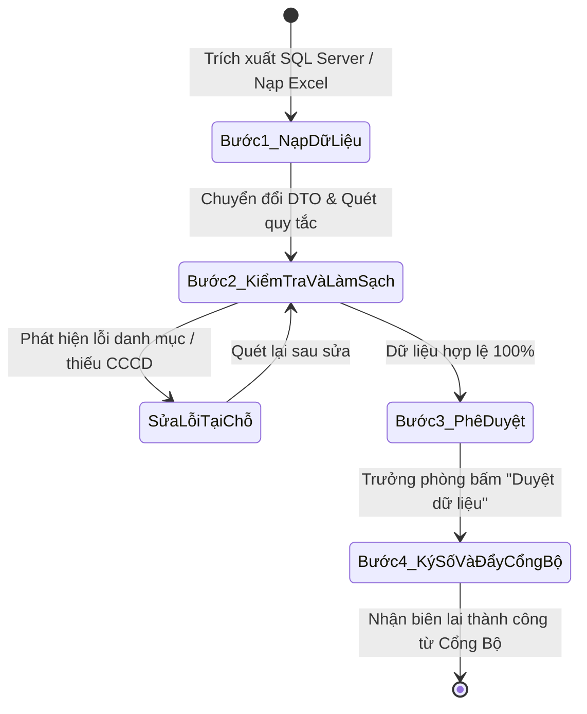

# CẨM NANG KỸ THUẬT DÀNH CHO AGENT: HỆ THỐNG TÍCH HỢP DỮ LIỆU HEMIS (TUU DATAHUB)
> **Tài liệu đặc tả kiến trúc, luồng xử lý và hướng dẫn thực thi tự động hóa cho AI Coding Agent**  
> *Dự án:* TUU DataHub - Tích hợp Cơ sở dữ liệu HEMIS Bộ GD&ĐT  
> *Đơn vị triển khai:* Trường Đại học Công đoàn  
> *Phiên bản:* 2.0 (Cập nhật Kiến trúc Single-Tenant & Stack .NET 10 LTS)

---

## 1. TỔNG QUAN NHIỆM VỤ & BỐI CẢNH DỰ ÁN (AGENT BRIEFING)

### 1.1. Mục Tiêu Chiến Dịch (Mission Statement)
Xây dựng và vận hành hệ thống **TUU DataHub** đóng vai trò là **Trục tích hợp dữ liệu trung gian** giữa hệ thống quản trị hiện tại của Trường Đại học Công đoàn và **Cổng CSDL Quốc gia HEMIS** của Bộ Giáo dục & Đào tạo theo Công văn số 6240/BGDĐT-CNTT.

### 1.2. Ràng Buộc Cốt Lõi (Critical Constraints)
1. **Thời hạn (Deadline):** Hoàn thành trong **30 ngày (4 tuần)**.
2. **Phạm vi nghiệp vụ:** Đồng bộ toàn diện **13 Phân hệ chuẩn Bộ GD&ĐT** (12 Endpoint REST API `db1`–`db13` và 01 Phân hệ xuất Excel chuẩn Bộ `db8`).
3. **Cơ chế bảo vệ chỉ tiêu (Safety-Net Protocol):** Trong trường hợp bất khả kháng, ưu tiên chốt dứt điểm **5 Phân hệ cốt lõi** (*Ngành, CTĐT, Cán bộ GV, Người học, Tuyển sinh*) trước để bảo toàn 100% chỉ tiêu tuyển sinh của Nhà trường.
4. **Kiến trúc dữ liệu:** Single-tenant On-Premise / Private Cloud, cô lập tuyệt đối dữ liệu, trích xuất SQL Server ở chế độ **Read-Only** để không ảnh hưởng hệ thống đang vận hành.
5. **Trạng thái phần mềm:** Hiện tại đang có **Khung kiến trúc & Bản thực nghiệm PoC (Proof-of-Concept)** hoàn chỉnh với 83 bản ghi seed mẫu để minh họa luồng 4 bước. Chưa phải bản triển khai dữ liệu thật tại trường.

---

## 2. STACK CÔNG NGHỆ & CẤU TRÚC REPOSITORY

### 2.1. Tech Stack Chuẩn
* **Backend:** `.NET 10 LTS`, C# 13, ASP.NET Core Web API, Clean Architecture (Domain, Application, Infrastructure, API).
* **Database & ORM:** `SQL Server 2022`, Entity Framework Core 10, Dapper (truy vấn báo cáo hiệu năng cao).
* **Background Jobs & Cache:** `Hangfire` (xử lý background job, retry cuốn chiếu) + `Redis` (caching danh mục, phân tán khóa lock).
* **ETL & Excel Engine:** `MiniExcel` (đọc/ghi streaming Excel dung lượng lớn không tràn RAM).
* **Ký số điện tử:** `XML-DSig` (W3C Standard XML Digital Signature), tích hợp USB Token PKCS#11 hoặc VNPT SmartCA / Viettel-CA qua HSM REST API.
* **Frontend:** `Next.js 14` (App Router), TypeScript, Tailwind CSS, Radix UI / shadcn/ui.
* **Testing & Mocking:** WireMock.Net / Custom Mock HEMIS Gateway mô phỏng Cổng Bộ.

### 2.2. Cấu Trúc Mã Nguồn (Repository Structure)
Thư mục gốc mã nguồn tại `/home/duwan/Code/hemis-integration`:
```text
hemis-integration/
├── hemis-integration-backend/
│   ├── src/
│   │   ├── Domain/                 # Entities, Value Objects, Enums, Domain Events
│   │   ├── Application/            # Use Cases, DTOs, Mappings, Interfaces, Validators (FluentValidation)
│   │   ├── Infrastructure/         # EF Core, Repositories, HEMIS ApiClient, MiniExcel ETL, XmlSigner
│   │   └── Api/                    # REST Controllers, Middlewares, DependencyInjection, Program.cs
│   ├── docker-compose.yml          # Backend + SQL Server + Redis
│   ├── docker-compose.mock.yml     # Mock HEMIS Gateway (Port 8081)
│   └── docker-compose.demo.yml     # Demo Seeder Service (Seed 83 records)
├── hemis-integration-frontend/
│   ├── src/
│   │   ├── app/                    # Next.js 14 App Router (dashboard, sync, logs, review)
│   │   ├── components/             # UI Components (DataTable, ErrorBadge, ApprovalModal)
│   │   ├── hooks/                  # React Hooks
│   │   └── lib/                    # API Clients, Utilities
│   └── package.json
└── hemis-integration-docs/         # Tài liệu đặc tả kỹ thuật chi tiết
```

---

## 3. DANH SÁCH 13 PHÂN HỆ VÀ QUY TẮC MAPPING DỮ LIỆU

Bộ GD&ĐT định nghĩa 13 phân hệ ký số. Khi giao tiếp với người dùng và trường, **bắt buộc dùng Tên Nghiệp Vụ Tiếng Việt**, không hiển thị mã kỹ thuật `db...` ra ngoài UI:

| STT | Tên Phân Hệ Chuẩn Bộ | Mã API Bộ | Nguồn Dữ Liệu | Đơn Vị Phụ Trách | Mức Độ Ưu Tiên |
| :---: | :--- | :---: | :---: | :--- | :---: |
| **1** | **Ngành Đào Tạo** | `db4` | SQL Server (Auto) | Phòng Quản lý Đào tạo | ⭐ Cốt lõi #1 |
| **2** | **Chương Trình Đào Tạo** | `db5` | SQL Server (Auto) | P. QLĐT / P. QLCL | ⭐ Cốt lõi #2 |
| **3** | **Đội Ngũ Cán Bộ, Giảng Viên** | `db3` | Excel / Hồ sơ | Phòng Tổ chức Cán bộ | ⭐ Cốt lõi #3 |
| **4** | **Người Học (Sinh Viên)** | `db7` | SQL Server (Auto) | P. QLĐT / P. CTSV | ⭐ Cốt lõi #4 |
| **5** | **Tuyển Sinh (Chỉ Tiêu & Trúng Tuyển)** | `db6` | SQL Server (Auto) | Phòng Quản lý Đào tạo | ⭐ Cốt lõi #5 |
| 6 | Cơ Sở Giáo Dục & Kiểm Định | `db1` | Excel mẫu chuẩn | P. QLCL / Phòng Hành chính | Bổ trợ |
| 7 | Hội Đồng Trường & BGH | `db2` | Excel mẫu chuẩn | Phòng Tổ chức Cán bộ | Bổ trợ |
| 8 | Cơ Sở Vật Chất & Đất Đai | `db9` | Excel mẫu chuẩn | Phòng HC-QT & Y tế | Bổ trợ |
| 9 | Khoa Học Công Nghệ & Đề Tài | `db10` | Excel mẫu chuẩn | Phòng QLKH & TTTL | Bổ trợ |
| 10 | Tài Chính & Tài Sản | `db11` | Excel mẫu chuẩn | Phòng Tài chính - Kế toán | Bổ trợ |
| 11 | Hợp Tác Quốc Tế | `db12` | Excel mẫu chuẩn | Viện ĐT, BD & HTQT | Bổ trợ |
| 12 | Hợp Tác Doanh Nghiệp & Việc Làm | `db13` | Excel mẫu chuẩn | P. GDCT & CTSV | Bổ trợ |
| 13 | Văn Bằng Tốt Nghiệp | `db8` | Xuất Excel chuẩn Bộ | Phòng Quản lý Đào tạo | Bổ trợ (Bộ chưa mở API) |

---

## 4. LUỒNG NGHIỆP VỤ 4 BƯỚC (THE 4-STEP PIPELINE)

Agent khi xây dựng tính năng hoặc gỡ lỗi phải tuân thủ tuyệt đối quy trình State Machine 4 bước:



### Bước 1: Thu thập & Nạp dữ liệu (Data Ingestion)
- **Nguồn CSDL Đào tạo:** Tạo `Read-Only Replica` hoặc user `db_datareader`. Sử dụng câu lệnh SQL SELECT tối ưu batch size 5,000 dòng.
- **Nguồn Excel phòng ban:** Tải template chuẩn Bộ (.xlsx). Sử dụng `MiniExcel` đọc streaming. Báo lỗi ngay nếu sai cấu trúc cột.

### Bước 2: Chuẩn hóa & Quét lỗi (Validation & Normalization)
- Khớp **>175 danh mục dùng chung của Bộ GD&ĐT** (Mã tỉnh, mã dân tộc, chức danh nghề nghiệp, ngạch giảng viên, mã trình độ...).
- Quét định dạng căn cước công dân: Đúng 12 số nguyên, không chứa ký tự đặc biệt.
- Quét định dạng ngày tháng: `dd/MM/yyyy` chuẩn ISO.
- Màn hình trực quan: Bôi đỏ ô lỗi, thông báo lỗi bằng tiếng Việt rõ ràng, cho phép sửa trực tiếp trên Web.

### Bước 3: Phê duyệt phân quyền (Approval Workflow)
- **Cơ chế:** Phân quyền theo vai trò (Role-based):
  - Chuyên viên phòng ban: Nạp và sửa dữ liệu.
  - Trưởng phòng ban: Xem báo cáo tổng hợp và bấm nút **"Duyệt & Chuyển Ký Số"**.
- Ghi nhận Audit Log: Thời gian duyệt, người duyệt, hash dữ liệu tại thời điểm duyệt.

### Bước 4: Đóng gói, Ký số & Đẩy Cổng HEMIS (Signing & Gateway Sync)
- Sinh cấu trúc XML theo chuẩn XML Schema của Bộ GD&ĐT.
- Bao gói chữ ký số `XML-DSig` (Enveloped Signature) bằng chứng thư số của Nhà trường.
- Gửi gói tin sang Cổng HEMIS qua giao thức REST API:
  - Xác thực qua OAuth2 Client Credentials (`/api/v1/auth/token`).
  - Gửi payload ký số (`POST /api/v1/sync/{module}`).
  - Lắng nghe phản hồi: Ghi nhận `TransactionId` và `Status: ACCEPTED / REJECTED`.

---

## 5. HƯỚNG DẪN THỰC THI & LỆNH ĐIỀU HÀNH (COMMAND CHEATSHEET)

### 5.1. Khởi Chạy Môi Trường Thực Nghiệm (Docker Compose)
Để khởi chạy toàn bộ hệ thống PoC kèm Mock Server Cổng Bộ và Seed dữ liệu mẫu:

```bash
cd /home/duwan/Code/hemis-integration/hemis-integration-backend

# 1. Khởi chạy toàn bộ hệ thống (Backend, Mock HEMIS, SQL Server, Redis, Demo Seeder)
docker compose -f docker-compose.yml -f docker-compose.mock.yml -f docker-compose.demo.yml up --build -d

# 2. Kiểm tra log của tiến trình seed dữ liệu mẫu
docker compose logs -f demo-seed

# 3. Khi thấy dòng log "Done. Database seeded successfully with 83 records", hệ thống đã sẵn sàng.
# API Swagger chạy tại: http://localhost:5000/swagger
# Mock HEMIS Gateway chạy tại: http://localhost:8081
# Web TUU DataHub chạy tại: http://localhost:8088
```

### 5.2. Chạy Kiểm Thử Unit Test & Integration Test
```bash
cd /home/duwan/Code/hemis-integration/hemis-integration-backend
dotnet test --logger "console;verbosity=detailed"
```

### 5.3. Sinh Slide Thuyết Trình Mới Nhất
```bash
node /home/duwan/.gemini/antigravity-ide/brain/0026e63b-a585-467c-8410-c16806e17e3f/scratch/generate_pptx.js
# Output: /home/duwan/Code/hemis/slide_thuyet_trinh_hemis.pptx
```

---

## 6. XỬ LÝ LỖI & KỊCH BẢN BIÊN (EDGE CASES & ERROR HANDLING)

| Mã lỗi / Tình huống | Nguyên nhân gốc rễ | Chiến lược xử lý tự động của Agent |
| :--- | :--- | :--- |
| **Thiếu / Sai định dạng CCCD** | File hồ sơ cũ chỉ có CMND 9 số hoặc thiếu số 0 ở đầu do Excel tự cắt | • Đánh dấu cảnh báo `WARNING_CCCD_FORMAT`.<br>• Cho phép chuyên viên sửa tại chỗ trên grid.<br>• Nếu là GV thỉnh giảng không có CCCD, map mã ngoại kiều nếu có hộ chiếu. |
| **Không khớp danh mục Bộ** | Tên chuyên ngành trong trường khác với Quyết định 1987 của Bộ | • Chạy thuật toán Levenshtein Distance gợi ý danh mục Bộ gần nhất (>85% khớp).<br>• Hiển thị dropdown để người dùng xác nhận mapping. |
| **Cổng Bộ phản hồi Timeout (504/408)** | Cổng HEMIS bị quá tải trong mùa cao điểm | • Không báo thất bại ngay.<br>• Đưa gói tin vào Hangfire Retry Queue với cơ chế Exponential Backoff (1m, 5m, 15m, 30m). |
| **Hết hạn Token OAuth2 (401)** | Token của Bộ hết hạn sau 3600s | • `HemisAuthHandler` tự động bắt mã 401, gọi làm mới token và phát lại request ban đầu trong suốt (Transparent retry). |
| **Trùng lặp mã người học (Mã SV)** | 1 sinh viên học 2 bằng hoặc chuyển ngành | • Kiểm tra khóa kết hợp `MaSinhVien + MaChuongTrinhDaoTao`.<br>• Nếu trùng tuyệt đối, thông báo bản ghi duplicate để người dùng chọn bản ghi mới nhất. |

---

## 7. QUY TẮC BẢO MẬT & SINGLE-TENANT
1. **Không rò rỉ dữ liệu:** Tuyệt đối không hardcode chuỗi kết nối (Connection String) hoặc Khóa ký số (Private Key) trong mã nguồn. Mọi bí mật cấu hình phải qua biến môi trường hoặc `appsettings.Production.json`.
2. **Read-Only Database Replica:** Mọi truy vấn sang hệ thống Đào tạo phải sử dụng Transaction với `IsolationLevel.ReadUncommitted` (`NOLOCK`) để tránh gây nghẽn khóa bảng trong giờ cao điểm học viên đăng ký tín chỉ.
3. **Audit Log:** Mọi thao tác tải file, chỉnh sửa dữ liệu và gửi Cổng Bộ phải lưu vết: `UserId`, `IPAddress`, `ActionType`, `OldValue`, `NewValue`, `Timestamp`.

---
*Tài liệu được bảo trì bởi Đội ngũ Kiến trúc Hệ thống TUU DataHub.*
